<div align="center">



<h1>Satish Kumar</h1>

<p>
  <a href="mailto:satish.240101236@iiitbh.ac.in"></a>
  <a href="https://github.com/Satish-011"></a>
  <a href="https://www.linkedin.com/in/satish-kumar-a48729324/"></a>
</p>

</div>

<h3 align="center">about</h3>

```js
const satish = {
  college: "IIIT Bhagalpur",
  degree: "B.Tech CSE, 2024–2028",
  focus: ["MERN stack", "competitive programming"],
  lead: "PYC, the Programming and Youth Club",
  learning: ["advanced Node.js", "Express architecture", "DSA"],
  openTo: "SDE internships",
};
```

<h3 align="center">stack</h3>

<p align="center">
  
  
  
  
  
  
  
  
  
  
  
  
  
</p>

<h3 align="center">ratings</h3>

<p align="center">
  <a href="https://codeforces.com/profile/Spectacles_01"></a>
  <a href="https://www.codechef.com/users/spectacles_01"></a>
  <a href="https://leetcode.com/u/gangmonk"></a>
</p>

<h3 align="center">projects</h3>

| project | what it does | stack |
| :-- | :-- | :-- |
| [Banking & Ledger API](https://github.com/Satish-011/Backend-ledger) | Banking backend with ACID transactions, custom sliding-window rate limiting and automated Redis caching | Node.js, Express, MongoDB, Redis, Docker, Jest, BullMQ |
<h3 align="center">stats</h3>

<p align="center">
  
  
</p>

<p align="center">
  
</p>

<p align="center">
  
</p>
